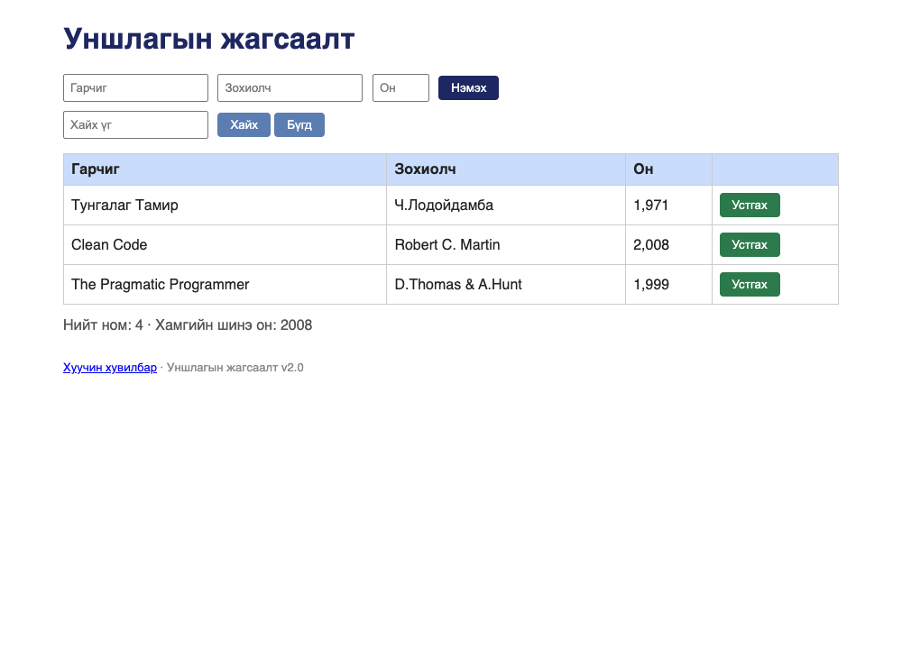

# BUG-01: Он хүснэгтэд мянгатын таслалтай («1,971») харагдана

Орчин:  Уншлагын жагсаалт v2.0, Google Chrome for Testing 153.0.8010.12, macOS 27.0.1, 2026-10-19
Урьдчилсан нөхцөл: `node app.js`-ийг шинээр асаасан (анхны 3 ном)

## Дахин гаргах алхам
1. `node app.js` ажиллуулаад браузераар http://localhost:3000 нээ.
2. Хүснэгтийн «Он» баганыг хар.

Хүлээгдэж байсан: «Он нь 1000-2100 хоорондох бүхэл тоо; хүснэгтэд энгийн тоогоор
(жишээ нь 1999) харагдана» — 1999 гэж харагдах ёстой.
Бодит үр дүн:     1,971 · 2,008 · 1,999 — мянгатын таслалтай харагдана. Он 99999
гэж оруулбал 99,999 гэж харагдана.

Ноцтой байдал: Minor — өгөгдөл алдагдаагүй ч бүх мөрөнд формат зөрчигдөж байна;
хэрэглэгч «1,971»-ийг хуулж өөр системд оруулахад тоо гэмтэнэ.
Хавсралт:      screenshots/bug-01.png
Олдсон аялал:  Supermodel

