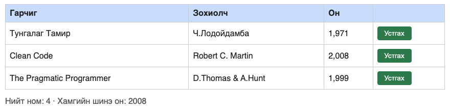

# BUG-02: «Нийт ном» тоолуур хүснэгтийн мөрийн тооноос үргэлж 1-ээр их

Орчин:  Уншлагын жагсаалт v2.0, Google Chrome for Testing 153.0.8010.12, macOS 27.0.1, 2026-10-22
Урьдчилсан нөхцөл: `node app.js`-ийг шинээр асаасан (анхны 3 ном)

## Дахин гаргах алхам
1. `node app.js` ажиллуулаад браузераар http://localhost:3000 нээ.
2. Хүснэгтийн мөрийн тоог тоол (3 ном) ба доорх «Нийт ном» тоог хар.
3. (Нэмэлт) Бүх номыг «Устгах» товчоор устгаад тоолуурыг дахин хар.

Хүлээгдэж байсан: «Нийт ном» тоолуур хүснэгтэд буй номын тоотой тэнцүү байх —
3 ном байхад «Нийт ном: 3», хоосон үед «Нийт ном: 0».
Бодит үр дүн:     3 ном байхад «Нийт ном: 4»; бүгдийг устгасан хоосон хүснэгтэд
«Нийт ном: 1» харагдана. Тоолуур үргэлж 1-ээр их.

API түвшний нотолгоо: `GET /api/books` нь 3 объект буцаахад `GET /api/stats`
нь `{"total":4,"newest":2008}` буцаана (evidence/bug-02-curl.txt).

Ноцтой байдал: Major — хэрэглэгчид харагдах тоо буруу тул жагсаалтын бүрэн бүтэн
байдалд итгэх боломжгүй; UI болон API хоёр түвшинд ижил зөрүү гарч байгаа нь
өгөгдлийн түвшний алдаа гэдгийг харуулна.
Хавсралт:      screenshots/bug-02.png · evidence/bug-02-curl.txt
Олдсон аялал:  Supermodel (UI) + Saboteur (API)

Дахин шалгасан: 2026-10-22 — шинээр асаасан апп дээр алхмыг яг дагаж, батлагдсан.
