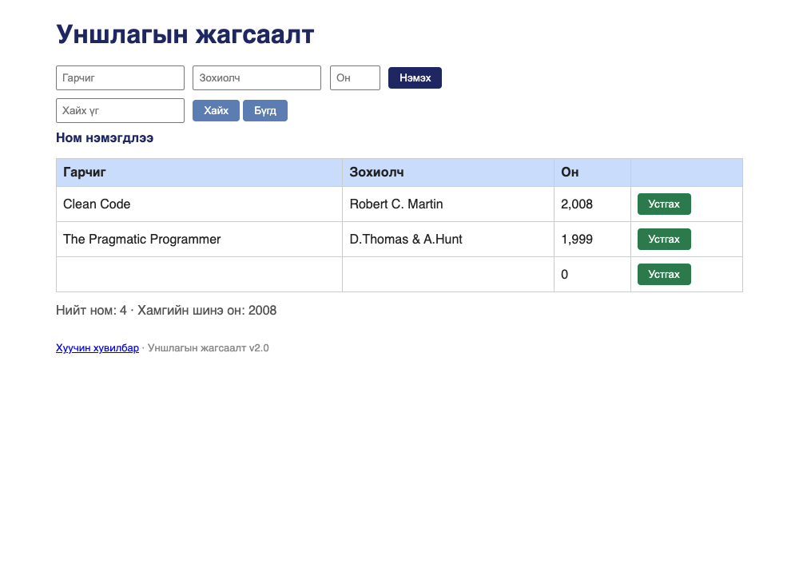

# BUG-03: Хоосон талбартай ном нэмэгдэж, «Ном нэмэгдлээ» гэж мэдэгдэнэ

Орчин:  Уншлагын жагсаалт v2.0, Google Chrome for Testing 153.0.8010.12, macOS 27.0.1, 2026-10-19
Урьдчилсан нөхцөл: `node app.js`-ийг шинээр асаасан (анхны 3 ном)

## Дахин гаргах алхам
1. `node app.js` ажиллуулаад браузераар http://localhost:3000 нээ.
2. Гарчиг, Зохиолч, Он гурван талбарыг ХООСОН орхи.
3. «Нэмэх» товчийг дар.

Хүлээгдэж байсан: «Ном нэмэхэд Гарчиг, Зохиолч, Он гурван талбар бүгд заавал
бөглөгдсөн байх ёстой; дутуу бол ном нэмэгдэхгүй, ойлгомжтой алдааны мессеж
харагдана» — ном нэмэгдэхгүй, алдааны мессеж гарна.
Бодит үр дүн:     Хүснэгтэд Гарчиг, Зохиолч нь хоосон, Он нь «0» гэсэн шинэ мөр
нэмэгдэж, «Ном нэмэгдлээ» гэсэн амжилтын мессеж гарна. Тоолуур 1-ээр нэмэгдэнэ.

Ноцтой байдал: Major — заавал бөглөх дүрэм хэрэгжихгүй, өгөгдлийн санд хоосон
бичлэг орж, хэрэглэгч амжилттай болсон гэж төөрөгдөнө.
Хавсралт:      screenshots/bug-03.png
Олдсон аялал:  Couch Potato

