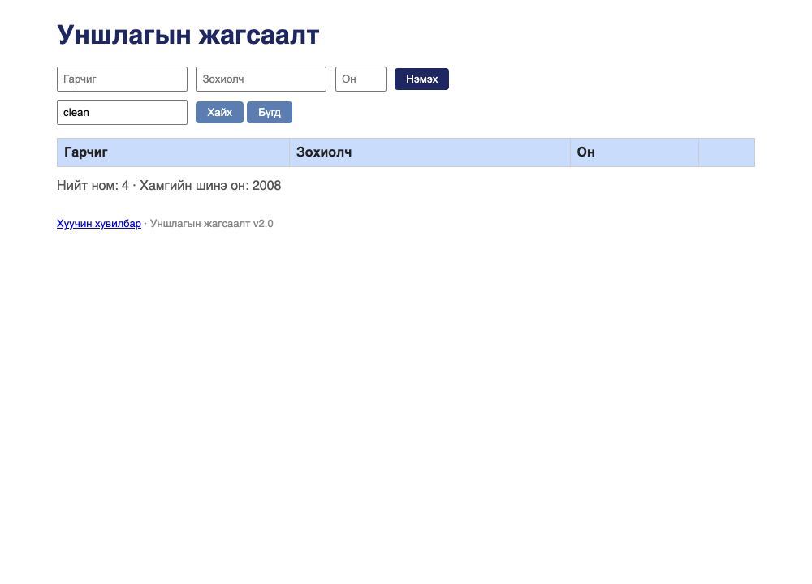

# BUG-04: Хайлт том/жижиг үсгийг ялгадаг — «clean» гэж хайхад илэрц гарахгүй

Орчин:  Уншлагын жагсаалт v2.0, Google Chrome for Testing 153.0.8010.12, macOS 27.0.1, 2026-10-19
Урьдчилсан нөхцөл: `node app.js`-ийг шинээр асаасан (анхны 3 ном)

## Дахин гаргах алхам
1. `node app.js` ажиллуулаад браузераар http://localhost:3000 нээ.
2. «Хайх үг» талбарт `clean` (бүх үсэг жижиг) гэж бичээд «Хайх» дар.
3. Дараа нь `Clean` (эхний үсэг том) гэж бичээд «Хайх» дар.

Хүлээгдэж байсан: «Хайлт гарчиг болон зохиолчоос хайх ба том/жижиг үсэг
ЯЛГАХГҮЙ» — хоёр тохиолдолд ч «Clean Code» ном олдох ёстой.
Бодит үр дүн:     `clean` → хүснэгт хоосон (0 илэрц). `Clean` → 1 илэрц.
Кирилл үсэгт ч мөн адил: `тунгалаг` → 0 илэрц, `Тунгалаг` → 1 илэрц.

Ноцтой байдал: Major — хайлт нь аппын гол функц; хэрэглэгч жижиг үсгээр хайх нь
хамгийн түгээмэл хэрэглээ тул илэрц «байхгүй» гэж буруу дүгнэнэ.
Хавсралт:      screenshots/bug-04.png
Олдсон аялал:  Couch Potato

