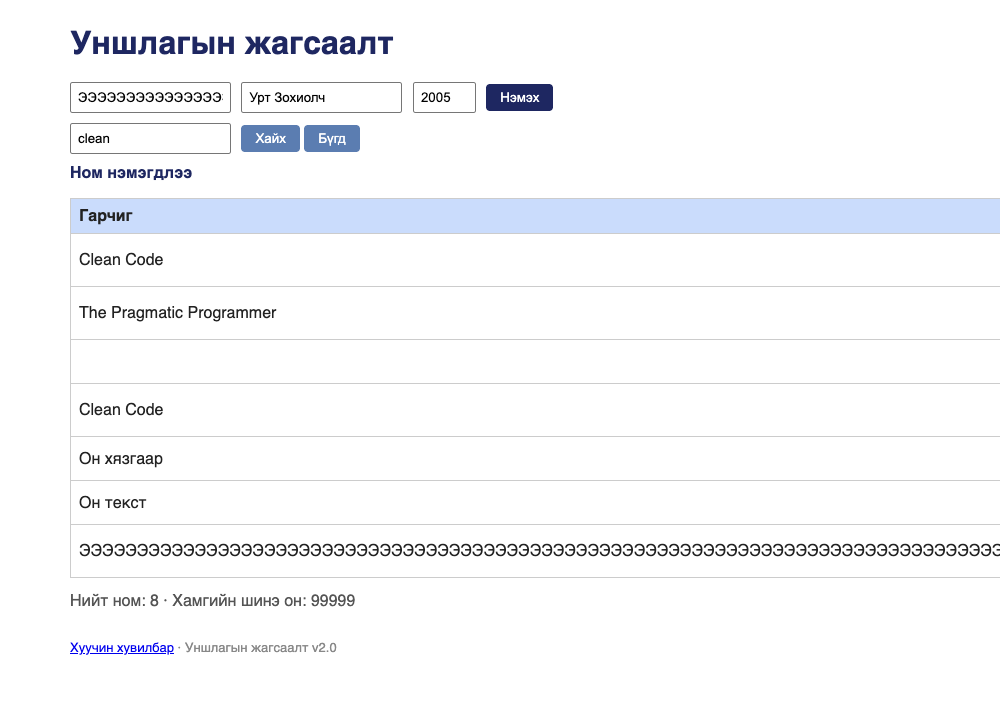

# BUG-06: Урт тасралтгүй гарчиг хүснэгтийг эвдэж, хуудсыг хэвтээ гүйлгэнэ

Орчин:  Уншлагын жагсаалт v2.0, Google Chrome for Testing 153.0.8010.12, macOS 27.0.1, 2026-10-22
Урьдчилсан нөхцөл: `node app.js`-ийг шинээр асаасан (анхны 3 ном)

## Дахин гаргах алхам
1. `node app.js` ажиллуулаад браузераар http://localhost:3000 нээ.
2. Гарчиг талбарт зайгүй 160 тэмдэгт бич (жишээ нь `Э` үсгийг 160 удаа).
3. Зохиолч = `Урт Зохиолч`, Он = `2005` гэж бөглөөд «Нэмэх» дар.
4. Хүснэгтийг болон хуудасны баруун ирмэгийг хар.

Хүлээгдэж байсан: «хүснэгт ямар ч урттай оролтод эвдрэхгүй» — урт гарчиг мөр
дотор шилжиж (wrap), бүх багана дэлгэцэд багтах ёстой.
Бодит үр дүн:     Хүснэгтийн өргөн 2135px болж (цонх 1000px), «Зохиолч», «Он»,
«Устгах» багана дэлгэцээс гарч, хуудасны нийт өргөн 2205px болж хэвтээ скролл
үүснэ. 1000px цонхонд зөвхөн «Гарчиг» багана харагдана.

Ноцтой байдал: Minor — өгөгдөл зөв хадгалагдсан, зөвхөн харагдац эвдэрсэн;
гэхдээ урт гарчигтай ном байхад устгах товч хүртэл дэлгэцээс гардаг.
Хавсралт:      screenshots/bug-06.png
Олдсон аялал:  Couch Potato

Дахин шалгасан: 2026-10-22 — шинээр асаасан апп дээр алхмыг яг дагаж, батлагдсан.
