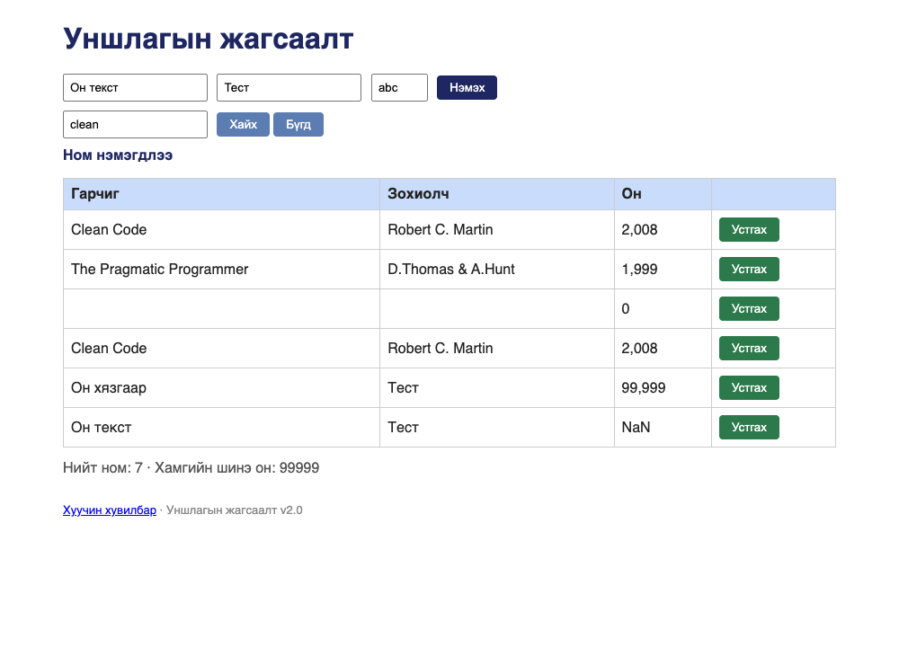

# BUG-07: Ном устгасны дараа «Ном нэмэгдлээ» гэсэн буруу мессеж гарна

Орчин:  Уншлагын жагсаалт v2.0, Google Chrome for Testing 153.0.8010.12, macOS 27.0.1, 2026-10-22
Урьдчилсан нөхцөл: `node app.js`-ийг шинээр асаасан (анхны 3 ном)

## Дахин гаргах алхам
1. `node app.js` ажиллуулаад браузераар http://localhost:3000 нээ.
2. Эхний мөрийн «Устгах» товчийг дар.
3. Хүснэгтийн доорх мессежийг хар.

Хүлээгдэж байсан: «Үйлдэл бүрийн дараах мессеж тухайн үйлдэлдээ тохирно» —
устгасны дараа «Ном устгагдлаа» гэх мэт устгалын мессеж гарна.
Бодит үр дүн:     Мөр хасагдсан ч мессеж «Ном нэмэгдлээ» гэж гарна.

Ноцтой байдал: Minor — өгөгдөл зөв устсан, зөвхөн мессеж буруу; хэрэглэгч
устгасан эсэхээ мессежээр баталгаажуулж чадахгүй.
Хавсралт:      screenshots/bug-07.png
Олдсон аялал:  Supermodel

Дахин шалгасан: 2026-10-22 — шинээр асаасан апп дээр алхмыг яг дагаж, батлагдсан.
