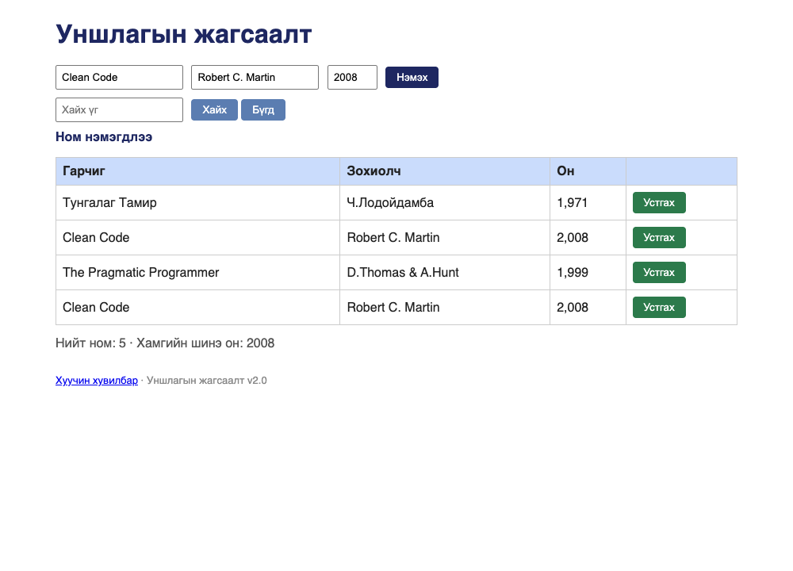

# BUG-09: Ижил гарчиг, зохиолчтой номыг давхардуулж нэмж болно

Орчин:  Уншлагын жагсаалт v2.0, Google Chrome for Testing 153.0.8010.12, macOS 27.0.1, 2026-10-19
Урьдчилсан нөхцөл: `node app.js`-ийг шинээр асаасан (анхны 3 ном)

## Дахин гаргах алхам
1. `node app.js` ажиллуулаад браузераар http://localhost:3000 нээ.
2. Гарчиг = `Clean Code`, Зохиолч = `Robert C. Martin`, Он = `2008` гэж бичээд
   «Нэмэх» дар.
3. Хүснэгтийг хар.

Хүлээгдэж байсан: «Ижил гарчиг, зохиолчтой ном давхардуулж нэмэгдэхгүй» —
4 дэх мөр нэмэгдэхгүй, «энэ ном аль хэдийн байна» гэсэн мессеж гарна.
Бодит үр дүн:     Хүснэгтэд яг ижил «Clean Code | Robert C. Martin | 2,008» мөр
хоёр дахь удаа нэмэгдэж, «Ном нэмэгдлээ» гэж мэдэгдэнэ. (Товчийг давхар дарахад
хоёр хувь нэмэгддэг.)

Ноцтой байдал: Major — давхардсан өгөгдөл үүсч, жагсаалт бохирдоно; хэрэглэгч
аль номоо устгахаа мэдэхгүй, тоолуур ч буруу болно.
Хавсралт:      screenshots/bug-09.png
Олдсон аялал:  Couch Potato

