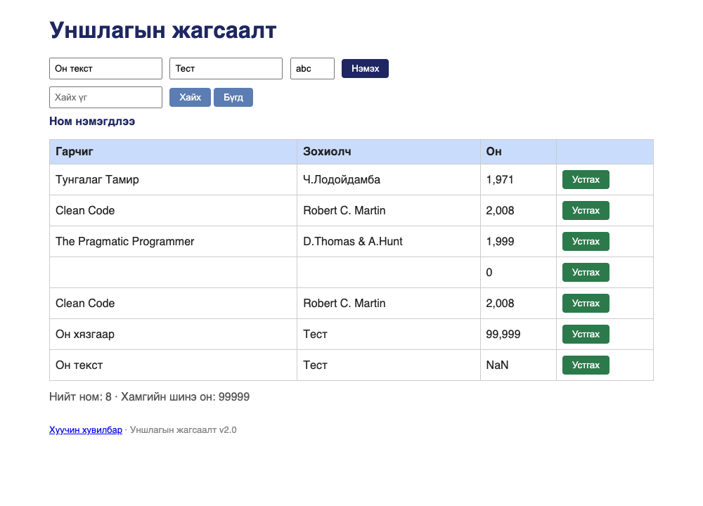

# BUG-10: Он 1000-2100 хязгаарт шалгагдахгүй — «99999» хүлээн авч, «abc» оруулбал NaN харагдана

Орчин:  Уншлагын жагсаалт v2.0, Google Chrome for Testing 153.0.8010.12, macOS 27.0.1, 2026-10-22
Урьдчилсан нөхцөл: `node app.js`-ийг шинээр асаасан (анхны 3 ном)

## Дахин гаргах алхам
1. `node app.js` ажиллуулаад браузераар http://localhost:3000 нээ.
2. Гарчиг = `Он хязгаар`, Зохиолч = `Тест`, Он = `99999` гэж бичээд «Нэмэх» дар.
3. Гарчиг = `Он текст`, Зохиолч = `Тест`, Он = `abc` гэж бичээд «Нэмэх» дар.
4. Хүснэгтийн «Он» баганыг хар.

Хүлээгдэж байсан: «Он нь 1000-2100 хоорондох бүхэл тоо» — 99999 болон abc хоёулаа
татгалзаж, алдааны мессеж гарах ёстой.
Бодит үр дүн:     Хоёулаа нэмэгдэнэ. «99999» нь «99,999» гэж, «abc» нь «NaN» гэж
харагдана. «Хамгийн шинэ он» тоолуур 99999 болж, бодит өгөгдлийг гажуудуулна.

API түвшний нотолгоо: `POST /api/books` нь `{"year":99999}` болон `{"year":"abc"}`
хоёуланд нь `201 Created` буцаана (evidence/bug-10-curl.txt).

Ноцтой байдал: Major — өгөгдлийн тогтвортой байдал алдагдаж, хүснэгтэд NaN болон
утгагүй он харагдана; статистик (хамгийн шинэ он) бүхэлдээ буруу болно.
Хавсралт:      screenshots/bug-10.png · evidence/bug-10-curl.txt
Олдсон аялал:  Couch Potato (UI) + Saboteur (API)

Дахин шалгасан: 2026-10-22 — шинээр асаасан апп дээр алхмыг яг дагаж, батлагдсан.
